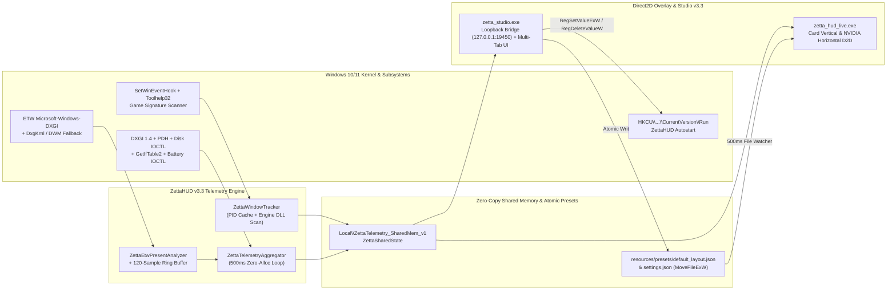

# ZettaHUD v3.3

**Ultra-Lightweight, Zero-Injection Hardware Telemetry, NVIDIA-Style Inline Overlay & WYSIWYG Control Studio for Windows 10/11 (x64)**

[](LICENSE)
[](CMakeLists.txt)
[](installer.iss)

ZettaHUD v3.3 is a native C++20 hardware telemetry engine, passive ETW/DWM present analyzer, Direct2D click-through overlay, and multi-tab desktop configuration studio (`ZettaHUD Studio v3.3`). Unlike traditional overlays that inject DLLs into target game processes and hook `IDXGISwapChain::Present` (risking anti-cheat bans or game crashes), ZettaHUD operates **100% out-of-process**.

---

## Key Highlights in v3.3

1. **Zero-Injection ETW & Hardware Telemetry Engine (including AMD ADL / NVML / WMI Thermal Probes)**
   - Captures real-time frame pacing, average FPS, and 1% Low FPS via passive Windows Event Tracing (`Microsoft-Windows-DXGI` & `DxgKrnl`) with an automatic non-admin DWM composition fallback.
   - Polls 13 hardware sensors (`DXGI 1.4`, `PDH`, `atiadlxx.dll` AMD ADL + `nvml.dll` + WMI thermal zones, `IOCTL_DISK_PERFORMANCE`, `GetIfTable2`, Battery IOCTLs, and process working sets) across a deterministic 1-byte-packed shared memory map (`Local\ZettaTelemetry_SharedMem_v1`).
2. **RTSS-Grade Game Signature Scanner (`ZettaWindowTracker`)**
   - Combines an event-driven `SetWinEventHook` tracker with per-PID classification caching (`knownGamePids`), an RTSS-style browser/Electron/system fast-reject blacklist, launcher directory whitelisting, and `CreateToolhelp32Snapshot` module signature verification (`unityplayer.dll`, `steam_api64.dll`, `bink2w64.dll`, `fmodstudio.dll`, `vulkan-1.dll`, `d3d12.dll`, `dxvk_d3d11.dll`).
3. **Dual Direct2D Rendering Modes (`CARD_VERTICAL` & `NVIDIA_HORIZONTAL`)**
   - **Card (Vertical):** Two-column tabular telemetry card with customizable backdrop opacity, corner radius, and a live 120-sample frametime graph.
   - **NVIDIA (Horizontal Inline):** Borderless single-line horizontal telemetry strip (`FPS 117 | LAT 8.5 ms | GPU 88 % | GPU_TMP 63 C | CPU 31 % | CPU_TMP 63 C | ...`) rendered with a 1px offset drop shadow (`#000000` at `0.8` opacity) for crisp legibility over bright in-game skies without a background container.
4. **Modernized Multi-Tab ZettaHUD Studio v3.3, System Tray & Registry Autostart**
   - **HUD Editor Tab:** Drag-and-drop 16:9 viewport canvas with 4px grid snapping, instant `CARD_VERTICAL` / `NVIDIA_HORIZONTAL` mode toggle with real-time HTML5 `<canvas>` inline preview, layer visibility management, and hex/swatch color customization.
   - **App Settings Tab:** Native Windows Startup registration (`HKCU\Software\Microsoft\Windows\CurrentVersion\Run\ZettaHUD` -> `zetta_studio.exe --background`), Win32 System Tray (`Shell_NotifyIconW`) integration, global hotkey selector, and Master Overlay start/stop process control persisted to `resources/presets/settings.json`.

---

## System Architecture



---

## Workspace Structure

```text
ZettaHUD/
├── CMakeLists.txt                                   # C++20 x64 build configuration
├── installer.iss                                    # Inno Setup v3.3 Windows x64 installer script
├── LICENSE                                          # MIT License
├── README.md                                        # ZettaHUD v3.3 documentation
├── docs/
│   └── ARCHITECTURE.md                              # Deterministic IPC byte-offset specification
├── resources/
│   ├── app.manifest                                 # PerMonitorV2 DPI Awareness manifest
│   ├── presets/
│   │   ├── default_layout.json                      # Live hot-reloaded HUD layout & layoutMode schema
│   │   └── settings.json                            # Persisted App Settings (autostart & global hotkeys)
│   └── studio/
│       └── index.html                               # ZettaHUD Studio v3.3 Multi-Tab UI (Editor + Settings)
├── include/
│   ├── ipc/
│   │   ├── ZettaSharedState.h                       # #pragma pack(push, 1) IPC structs (5,063 bytes)
│   │   └── ZettaSharedMemoryManager.hpp             # RAII CreateFileMappingW + Named Mutex manager
│   ├── tracker/
│   │   └── ZettaWindowTracker.hpp                   # RTSS-grade Game Signature Scanner + PID cache
│   ├── telemetry/
│   │   ├── ZettaCpuRamCollector.hpp                 # GetSystemTimes delta, System RAM, Process Working Set
│   │   ├── ZettaGpuVramCollector.hpp                # DXGI 1.4 + PDH 3D Engine Load, Dedicated & Shared VRAM
│   │   ├── ZettaStorageNetCollector.hpp             # PhysicalDrive0 IOCTL_DISK_PERFORMANCE & GetIfTable2 Net I/O
│   │   ├── ZettaPowerBatteryCollector.hpp           # Battery IOCTL wattage (W), capacity (%), AC/DC state
│   │   └── ZettaTelemetryAggregator.hpp             # 500ms coordinator populating 11 sensor slots + frameGraph
│   ├── etw/
│   │   ├── ZettaFrameRingBuffer.hpp                 # 120-sample ring buffer + 256-sample P99 (1% Low) window
│   │   └── ZettaEtwPresentAnalyzer.hpp              # Real-Time ETW trace + Non-Admin DWM composition fallback
│   ├── overlay/
│   │   ├── ZettaLayoutConfig.hpp                    # JSON parser supporting CARD_VERTICAL & NVIDIA_HORIZONTAL
│   │   ├── ZettaD2DRenderer.hpp                     # Direct2D Card & Shadowed NVIDIA Horizontal Inline renderer
│   │   └── ZettaOverlayWindow.hpp                   # Click-through topmost layered window + global hotkeys
│   └── studio/
│       └── ZettaStudioBridgeServer.hpp              # Loopback HTTP/IPC bridge (/api/layout, /api/settings)
└── src/
    ├── daemon/
    │   ├── main_phase1_test.cpp                     # Phase 1: Window Tracker & Shared Memory test harness
    │   ├── main_phase2_test.cpp                     # Phase 2: Hardware Telemetry Collectors CLI harness
    │   └── main_phase3_test.cpp                     # Phase 3: Passive ETW/DWM Frame Analyzer CLI harness
    ├── overlay/
    │   └── main_phase4_overlay.cpp                  # Phase 4: Native Direct2D Transparent HUD Overlay
    └── studio/
        └── main_phase5_studio.cpp                   # Phase 5: ZettaHUD Studio v3.3 & Registry Autostart
```

---

## Build & Installation Instructions

### 1. Compile Production Binaries (`clang++` C++20)

```powershell
# Compile Win32 Icon Resource
windres resources/zetta.rc -I resources -o build/zetta_res.o

# Compile Direct2D Transparent Click-Through Overlay (zetta_hud_live.exe)
clang++ -std=c++20 -O2 -Wall -Wextra -Wpedantic -Werror `
  -DUNICODE -D_UNICODE -DWIN32_LEAN_AND_MEAN -DNOMINMAX -D_WIN32_WINNT=0x0A00 -DWINVER=0x0A00 `
  -Iinclude src/overlay/main_phase4_overlay.cpp build/zetta_res.o `
  -ld2d1 -ldwrite -ldwmapi -ldxgi -lpdh -liphlpapi -lsetupapi -lpowrprof -ladvapi32 -luuid -lole32 -loleaut32 -lwbemuuid -lgdi32 -luser32 `
  -o build/zetta_hud_live.exe

# Compile ZettaHUD Studio v3.3 & Loopback Bridge (zetta_studio.exe)
clang++ -std=c++20 -O2 -Wall -Wextra -Wpedantic -Werror `
  -DUNICODE -D_UNICODE -DWIN32_LEAN_AND_MEAN -DNOMINMAX -D_WIN32_WINNT=0x0A00 -DWINVER=0x0A00 `
  -Iinclude src/studio/main_phase5_studio.cpp build/zetta_res.o `
  -lws2_32 -lshell32 -ladvapi32 -luser32 -lgdi32 `
  -o build/zetta_studio.exe
```

### 2. Build the Windows Installer (`installer.iss`)

Compile [`installer.iss`](installer.iss) using **Inno Setup Compiler 6** (`ISCC.exe installer.iss`) to generate `dist\ZettaHUD_v3.3_Setup_x64.exe`, which installs `zetta_studio.exe`, `zetta_hud_live.exe`, `resources\`, and `LICENSE` into `C:\Program Files\ZettaHUD` with Desktop and Start Menu shortcuts.

### 3. Launch & Verify

```powershell
# Run end-to-end loopback API self-test (/api/telemetry, /api/layout, /api/settings)
.\build\zetta_studio.exe --self-test

# Launch ZettaHUD Studio v3.3
.\build\zetta_studio.exe
```

---

## License

Licensed under the [MIT License](LICENSE). Copyright (c) 2026 Raf446.
